# CortexProbe

Fit 2D Gaussian receptive fields from aperture masks and frame responses with
Python, NumPy, and SciPy. **Examples and results are synthetic; no human-data
or neural-network evaluation.**

## Pipeline

[](docs/figures/pipeline.png)

[Full-size diagram](docs/figures/pipeline.svg) · [Edit in Figma](https://www.figma.com/design/SLnekFxRy403s5HqmehcOz?node-id=9-2)

[Documentation](https://urmeo.github.io/cortexprobe/)

## How it works

1. **Match the inputs.** Build bar, wedge, or ring masks, or supply your own.
   Align each retained mask with its response and group label.
2. **Estimate a field.** Search candidate Gaussians, then refine center and width
   within bounds. At each geometry, solve amplitude and baseline by linear least
   squares. The fit returns five parameters, in-sample R², local standard errors,
   and acceptance checks.
3. **Test held-out groups.** Fit the training groups independently. Freeze all
   five parameters to predict the excluded group's responses. Report each fold's
   R², their finite-score mean and sample SD, and valid-fold coverage.

Fit acceptance and held-out validation answer separate questions. Acceptance
checks convergence and fit rules; held-out scores measure prediction on excluded
frames. A fit can be accepted without complete or strong held-out validation.

## Run

Use Python 3.9 or later.

```bash
git clone https://github.com/urmeo/cortexprobe.git
cd cortexprobe
python3 -m venv .venv
source .venv/bin/activate
python -m pip install -r requirements.txt
export PYTHONPATH="$PWD/src"
python scripts/fit_synthetic.py
```

The noiseless example prints:

```text
center=(12.0, 8.0), sigma=5.0, accepted=True
held-out R²=1.000; valid folds=4/4; validation=complete
```

Use Python 3.10 or later for tests, plots, and documentation:

```bash
python -m pip install -r requirements-dev.txt
python -m pytest tests -q
python scripts/build_docs.py
```

The documentation build writes `_site/index.html`.

<details markdown="1">
<summary>API and fit rules</summary>

The [example](https://github.com/urmeo/cortexprobe/blob/main/scripts/fit_synthetic.py)
shows fitting and validation calls.

| Input | Shape or unit |
|---|---|
| Apertures | `(frames, height, width)`; spatial dimensions match the grid |
| Responses | `(frames,)` for one unit; `(frames, units)` for multiple units |
| Groups | One finite numeric label per retained frame; at least two groups |
| Center and sigma | Pixels; centered origin, x rightward, y upward |

`fit_unit` and `validate_unit` handle one response; `fit_all` and `validate_all`
handle matrices. Center and sigma are in pixels; amplitude and baseline retain
response units. There is no haemodynamic convolution.

Match responses to retained masks. Bar directions must be unique integer degrees
in `[0, 360)`; opposite sweeps share a group. Generated masks are pruned for
cross-group overlap; external masks are not. Overlap checks do not cover all
data dependence. Fitter and validator inputs are copied and exposed read-only;
create a new instance to change them.

Acceptance requires convergence, the configured in-sample R² threshold,
positive amplitude, and sigma away from its bounds. Center bounds, undefined
errors, and held-out scores do not determine acceptance. Fitting requires more
than five frames.

`cv_r2` and `cv_r2_sd` summarize finite fold scores. `n_valid_folds` counts
finite scores; `n_total_folds` includes skipped groups with insufficient training
frames. `validation_complete` requires a finite score for every requested fold.
R² is `NaN` for constant targets, nonfinite inputs, or failed fits.

Standard errors use a local Jacobian and distinct-mask count minus five degrees
of freedom. Repeated masks, including signed-zero copies, do not increase that
count; this is conservative for independent repeat noise. Singular fits have
undefined errors. Student-t intervals assume local linearity and approximately
Gaussian residuals. Rings alone cannot identify polar angle.

</details>

<a id="watch-the-workflow"></a>

## Results

### Current code checks

These synthetic checks use a 64 × 64 grid, four groups, 300 candidates,
sigma bounds of 1–10 pixels, amplitude 3, and baseline 0.5. Noisy responses
use Gaussian noise with SD equal to 20% of each clean response's SD.
Localization uses 16 units and seeds 100–115. Prediction, fold estimates, and
solver limits use field `(12, 8, 5)` and seed 7. These single draws do not
establish general accuracy bounds.

[Measurements and provenance](results/measurements.csv) · [Plot script](https://github.com/urmeo/cortexprobe/blob/main/scripts/plot_results.py)

**Sampling.** Exposure frequency after pruning, using each design's retained frames.

[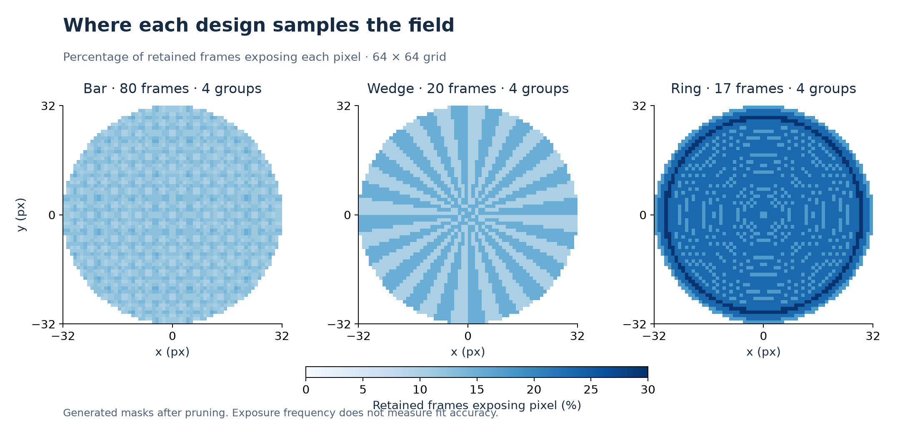](results/aperture-coverage.png)

**Localization.** Known and fitted centers for 16 units. At 20% noise,
mean center error is 0.215 pixels; the largest error is 0.620 pixels in this batch.

[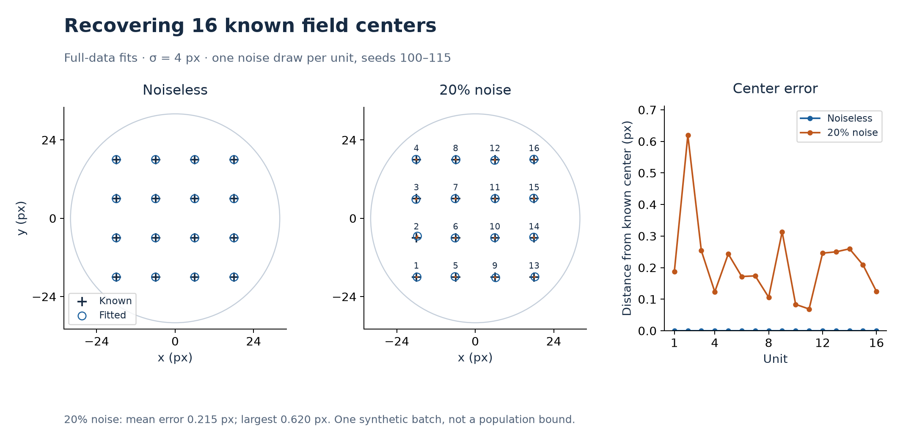](results/field-localization.png)

**Prediction.** Each frame is predicted by a model trained without its group.
Mean fold R² is 0.964; all four folds have finite scores.

[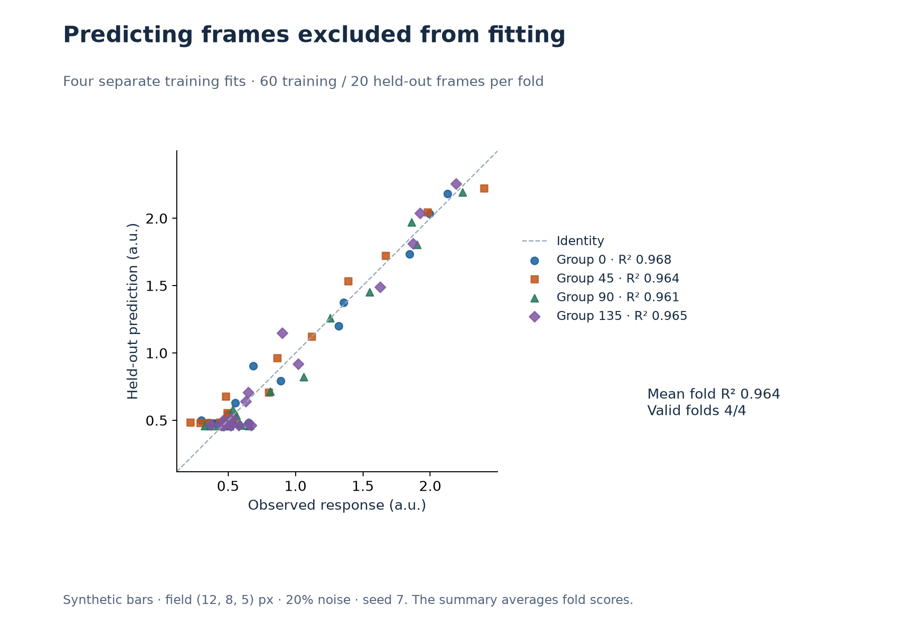](results/held-out-predictions.png)

**Fold estimates.** Four training fits compared with the known values and full-data fit.

[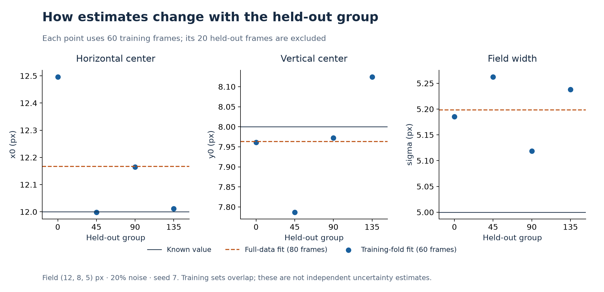](results/fold-stability.png)

**Solver limits.** Fit score, center error, and reported evaluations at seven stopping budgets.

[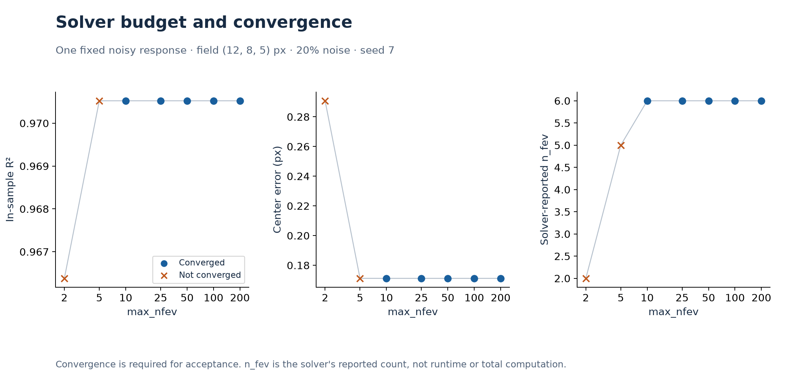](results/solver-budget.png)

To regenerate these five figures and their CSV, install the development
requirements and run `python scripts/plot_results.py` with `PYTHONPATH=src`.
The CSV records the source hash, seeds, settings, date, and library versions.

### Apertures and responses

A known field produces `3 × aperture–field overlap + 0.5`.

[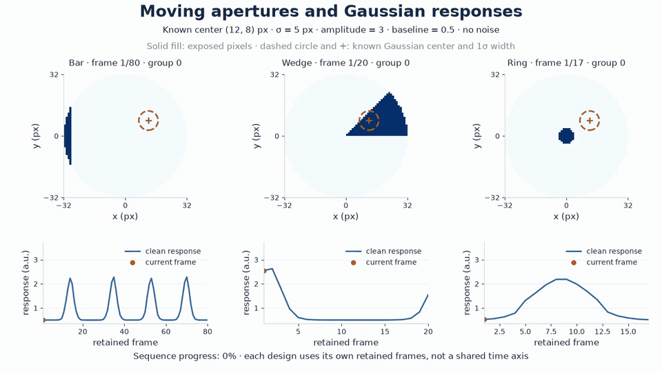](docs/media/aperture-response.mp4)

[Watch video](https://urmeo.github.io/cortexprobe/#apertures-and-responses) · [MP4](docs/media/aperture-response.mp4)

### Held-out prediction

Each model fits three groups and predicts the fourth without refitting.

[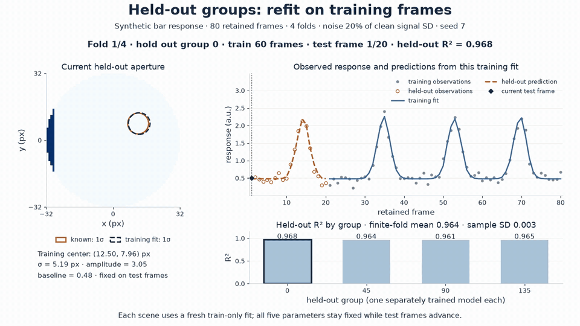](docs/media/grouped-validation.mp4)

[Watch video](https://urmeo.github.io/cortexprobe/#held-out-prediction) · [MP4](docs/media/grouped-validation.mp4)

<details markdown="1">
<summary>Animation conditions</summary>

These silent, 10-second videos illustrate a 64 × 64 pixel grid and field
`(12, 8, 5)` in pixels. Retained frames/groups: bars 80/4, wedges 20/4, rings
17/4. Rings retain 17 of 20 frames after pruning.
[Aperture frames](docs/figures/stimuli.png) show masks and groups.
Playback aligns relative progress, not acquisition times.

The prediction video uses bars, 20% Gaussian noise relative to clean-response
SD, and seed 7. Frames show predictions, not optimizer iterations; scores
average finite fold R² rather than pooling predictions. These are illustrations,
not additional evaluations.

</details>

<details markdown="1">
<summary>Recorded experiments, figures, and conditions</summary>

### Fits and checks

<a id="from-aperture-to-response"></a>

**Forward model.** Gaussian–aperture overlap gives the predicted response.

[](docs/figures/model.png)

**Response fit.** Field `(12, 8, 5)`, 20% Gaussian noise, seed 7.

[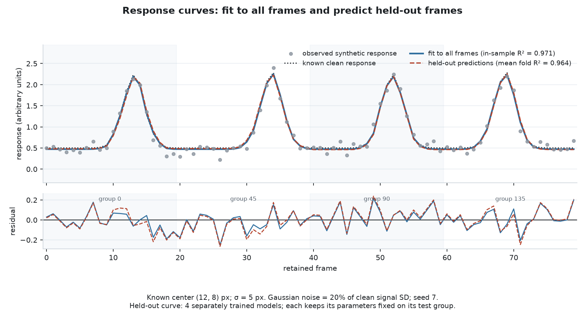](docs/figures/fitted-response.png)

<a id="recovery-and-uncertainty"></a>

**Recovery.** Position and width errors for five known fields at three noise levels.

[](docs/figures/recovery.png)

**Uncertainty.** Nominal 95% intervals covered `x0` in 91.5–93.5% of recorded
trials. Intervals are approximate; noiseless errors reach a numerical floor.

[](docs/figures/uncertainty.png)

<a id="autocorrelation-and-validation"></a>

**Noise.** White and width-3 moving-average noise, seeds 21–40.
Autocorrelation describes the noise, not fit quality.

[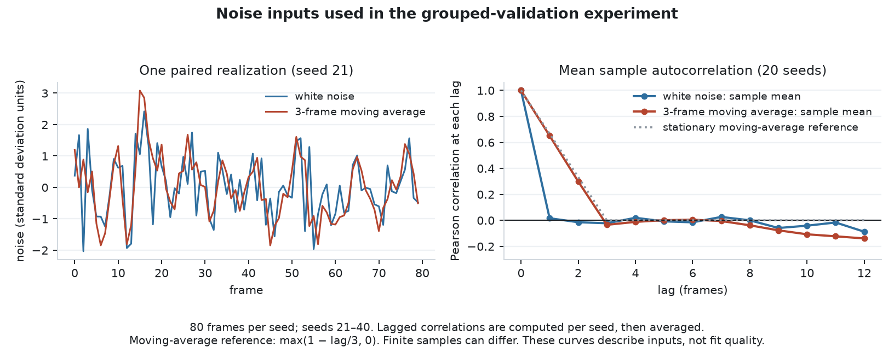](docs/figures/noise-autocorrelation.png)

**Splits.** Random-frame scores can exceed grouped scores without a field
signal. Both recorded means for correlated noise were negative.

[](docs/figures/leakage.png)

**Overlap.** Cross-group mask similarity before and after grouping opposite
sweeps and pruning similar frames.

[](docs/figures/fold-leakage.png)

<a id="model-limits"></a>

**Grid limits.** Sigma must be at least one pixel. Its upper bound retains at
least 99% of a centered Gaussian's sampled mass inside the circular field;
edge fields can still lose mass.

[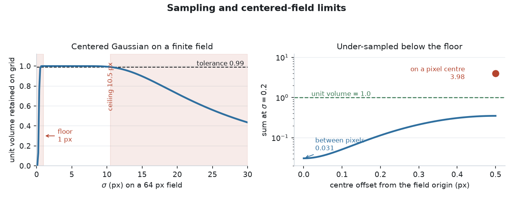](docs/figures/sigma-guard.png)

**Model mismatch.** A two-lobe response can pass single-Gaussian acceptance.
Residual second-field gain has no universal rejection threshold.

[](docs/figures/misspecification.png)

<a id="recorded-runtime"></a>

**Runtime.** Hardware-specific timings exclude fitter setup. Validation includes
four training-fold fits and a full-data fit.

[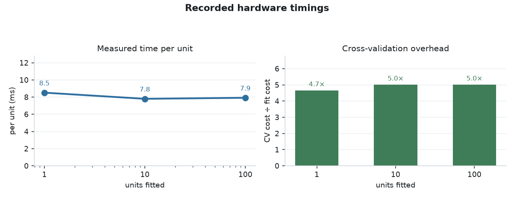](docs/figures/runtime.png)

These saved results use a 64 × 64 grid, 80 bar frames, four groups,
300 candidates, sigma 1–10 pixels, amplitude 3, and baseline 0.5 unless stated.
Noise is relative to the clean response's SD.

<a id="recovery"></a>

**Recovery.** Fields `(x0, y0, sigma)` in pixels: `(0, 0, 5)`, `(12, 8, 4)`,
`(-10, 14, 7)`, `(16, -12, 6)`, `(-15, -9, 9)`. Conditions share seed 7;
maxima describe these five fits in one draw, not worst-case bounds. R² is
in-sample. Pure noise uses 40 independent columns, seed 11, threshold 0.2.

<!-- BEGIN GENERATED: recovery -->
| Condition | Position error, largest (px) | mean (px) | Sigma error, largest (%) | mean (%) | Minimum R² |
|---|---|---|---|---|---|
| Noiseless | 0.000 | 0.000 | 0.0 | 0.0 | 1.0000 |
| 20% noise | 0.287 | 0.197 | 5.2 | 2.3 | 0.9696 |
| 50% noise | 0.772 | 0.511 | 12.8 | 5.6 | 0.8326 |
| Pure noise | n/a | n/a | n/a | n/a | **40 / 40 rejected** |

<sub>n = 5, shared noise seed 7; pure noise 0/40 accepted (best R² 0.1947, threshold 0.2). Recorded on macOS-26.6.1 arm64, Python 3.12.13, NumPy 2.5.2, SciPy 1.18.0 | config digest `4d6a856a499e` | generated 2026-08-19</sub>
<!-- END GENERATED: recovery -->

<a id="parameter-uncertainty"></a>

**Uncertainty.** The standard-error example uses field `(12, 8, 5)`, seed 5,
and `x0` in pixels. Coverage uses 200 trials per cell, paired seeds 1000–1199,
and fields `(12, 8, 5)` and `(28, 0, 4)`. Cells are not independent; coverage
intervals use the Wald approximation.

<!-- BEGIN GENERATED: uncertainty -->
| Noise | Fitted x0 | SE | 95 % CI width |
|---|---|---|---|
| 0.0 | 12.000 | 0.0000 | 0.000 |
| 0.1 | 11.962 | 0.0961 | 0.383 |
| 0.3 | 11.909 | 0.2806 | 1.118 |
| 0.6 | 11.881 | 0.5354 | 2.133 |

| Position | Noise | n | Coverage | 95 % Wald CI |
|---|---|---|---|---|
| interior | 0.2 | 200 | 0.935 | [0.901, 0.969] |
| interior | 0.5 | 200 | 0.930 | [0.895, 0.965] |
| near edge | 0.2 | 200 | 0.930 | [0.895, 0.965] |
| near edge | 0.5 | 200 | 0.915 | [0.876, 0.954] |

<sub>Nominal 95%; paired seeds across cells; noiseless SE is a numerical floor. Recorded on macOS-26.6.1 arm64, Python 3.12.13, NumPy 2.5.2, SciPy 1.18.0 | config digest `4d6a856a499e` | generated 2026-08-19</sub>
<!-- END GENERATED: uncertainty -->

<a id="grouped-and-random-splits"></a>

**Splits.** White noise is independent across frames. Correlated noise uses a
width-3 boxcar with `mode="same"`; random splits use seed 0 and four folds.
Scores average finite fold R². Leak is random minus grouped R²; negative R²
means worse predictions than the held-out mean.

<!-- BEGIN GENERATED: cross_validation -->
| Response | n seeds | Grouped CV | Random-split CV | Leak | Leak positive |
|---|---|---|---|---|---|
| White | 20 | -0.248 ± 0.135 | -0.339 ± 0.192 | -0.091 ± 0.231 | 8 / 20 |
| Autocorrelated | 20 | -0.624 ± 0.385 | -0.164 ± 0.189 | +0.459 ± 0.402 | 17 / 20 |

<sub>Mean ± SD, seeds 21-40; width-3 boxcar lag-1 0.651 ± 0.086 (theory 0.667). Recorded on macOS-26.6.1 arm64, Python 3.12.13, NumPy 2.5.2, SciPy 1.18.0 | config digest `4d6a856a499e` | generated 2026-08-19</sub>
<!-- END GENERATED: cross_validation -->

<a id="runtime"></a>

**Runtime.** Responses use 20% noise, amplitude 1, baseline 0, and seed 0.
Centers are sampled within ±70% of the field radius; sigma is 3–8 pixels.
Timings apply to the recorded machine and unit counts.

<!-- BEGIN GENERATED: runtime -->
| Units | Fit (s) | Per unit (ms) | CV (s) | CV factor |
|---|---|---|---|---|
| 1 | 0.009 | 8.5 | 0.040 | 4.7× |
| 10 | 0.078 | 7.8 | 0.391 | 5.0× |
| 100 | 0.792 | 7.9 | 3.978 | 5.0× |

<sub>Hardware timings; 4 folds plus the full fit. Recorded on macOS-27.0.1 arm64, Python 3.12.13, NumPy 2.5.3, SciPy 1.18.1 | config digest `4d6a856a499e` | generated 2026-10-06</sub>
<!-- END GENERATED: runtime -->

Original experiment and media generators are not included. The plot script
regenerates the five current-code checks; it does not update these recorded
tables, original figures, or videos.

</details>

## Roadmap

- Validate fitted fields and interval coverage on measured response data.
- Test rejection criteria for multi-lobe model mismatch.

## References

- Branch, M. A., Coleman, T. F., & Li, Y. (1999). A subspace, interior, and conjugate gradient method for large-scale bound-constrained minimization problems. *SIAM Journal on Scientific Computing, 21*(1), 1–23. [https://doi.org/10.1137/S1064827595289108](https://doi.org/10.1137/S1064827595289108)
- Dumoulin, S. O., & Wandell, B. A. (2008). Population receptive field estimates in human visual cortex. *NeuroImage, 39*(2), 647–660. [https://doi.org/10.1016/j.neuroimage.2007.09.034](https://doi.org/10.1016/j.neuroimage.2007.09.034)
- Golub, G. H., & Pereyra, V. (1973). The differentiation of pseudo-inverses and nonlinear least squares problems whose variables separate. *SIAM Journal on Numerical Analysis, 10*(2), 413–432. [https://doi.org/10.1137/0710036](https://doi.org/10.1137/0710036)
- Kriegeskorte, N., Simmons, W. K., Bellgowan, P. S. F., & Baker, C. I. (2009). Circular analysis in systems neuroscience: The dangers of double dipping. *Nature Neuroscience, 12*(5), 535–540. [https://doi.org/10.1038/nn.2303](https://doi.org/10.1038/nn.2303)

## License

[MIT](LICENSE)
